# Quant Engine

A backtesting and Monte Carlo risk engine for daily US equity strategies, with a React dashboard. It runs single-asset mean reversion, pairs trading and time-series momentum, each with an optional volatility-targeting overlay and, for the single-asset strategies, a long-only switch. Results come split in-sample and out-of-sample, with conservative accounting: a one-day execution lag by default, per-leg trading costs, an optional borrow fee on shorts, and cash at the T-bill rate.

Several tools test how much a result can be trusted:
- a cost sweep with the break-even cost;
- rolling one-year Sharpe and beta, and calendar returns;
- a parameter grid with the deflated Sharpe ratio, which discounts the best cell for the number of cells tried;
- Monte Carlo projections with GBM and a block bootstrap, checked against closed-form VaR and CVaR.

- **Specification:** [CLAUDE.md](CLAUDE.md), the source of truth for every formula and rule.
- **Methodology:** [docs/METHODOLOGY.md](docs/METHODOLOGY.md) justifies each formula, lists the limitations, and records every approved deviation from the specification.
- **Status:** Phases 0–5 are done: the engine, the API, the dashboard, the documentation and the benchmarks, then costs and robustness metrics. Phases 6–9 are specified in CLAUDE.md §16 but not built yet.

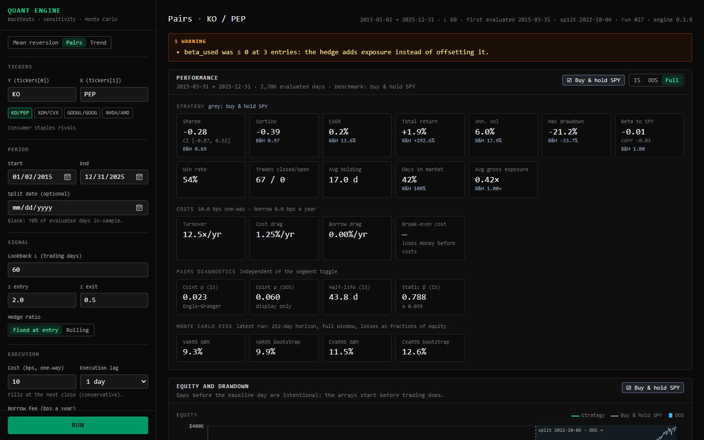

*KO/PEP pairs, 2015-01-02 to 2025-12-31, default settings. More views [below](#screenshots).*

## Setup (PowerShell)

Requires Python 3.12+ and Node 24+.

```powershell
Copy-Item .env.example .env

cd backend
py -m venv .venv
.venv\Scripts\python.exe -m pip install -r requirements-dev.txt

cd ..\frontend
npm ci
```

## Run

```powershell
# Terminal 1: API on http://localhost:8000 (interactive docs at /docs)
cd backend
.venv\Scripts\python.exe -m uvicorn app.main:app --reload --env-file ..\.env

# Terminal 2: dashboard on http://localhost:5173
cd frontend
npm run dev
```

Prices are downloaded from Yahoo Finance on first use and cached in `backend\quant.db`.

## Tests and linters

```powershell
cd backend
.venv\Scripts\ruff.exe check
.venv\Scripts\ruff.exe format --check
.venv\Scripts\python.exe -m pytest

cd ..\frontend
npm run lint
npm test
npm run build
```

The backend tests use synthetic data and a fake network, so they never reach Yahoo.

## Benchmarks

Every runtime figure in this repository comes from `scripts/bench.py`:

```powershell
cd backend
.venv\Scripts\python.exe scripts\bench.py
```

The bench keeps its own price cache, `backend\bench.db`, so it never touches the app's database or run history. Its first run downloads the data, and every timed request after that is served from the cache. Requests go through FastAPI's TestClient in process, so the times include validation, the engine, storing the run and JSON encoding, but no network or browser.

The tables below are copied from its output on 2026-10-17, with the dev servers stopped:

- CPU: AMD Ryzen 7 PRO 8840HS w/ Radeon 780M Graphics, 16 logical cores; RAM: 59.7 GiB
- OS: Windows-11-10.0.26220-SP0; Python 3.14.6 (CPython)
- Libraries: numpy 2.5.4, pandas 3.0.6, scipy 1.18.1, statsmodels 0.15.0, fastapi 0.143.2, starlette 1.8.0, pydantic 2.14.1, SQLAlchemy 2.1.4
- Data: KO/PEP pairs, every other setting default, 2011-01-01 to 2025-12-31: 3,772 trading days, from bench.db (no downloads)
- Each row: 10 timed runs after one warm-up run, wall clock (time.perf_counter)

**CLAUDE.md §14 targets**

| Workload | Median | Min | Max | Target | Met |
|---|---:|---:|---:|---:|---:|
| 15-year pairs backtest, first request on the data (diagnostics computed) | 390 ms | 353 ms | 418 ms | < 300 ms | **no** |
| 15-year pairs backtest, z_entry changed (diagnostics cached) | 165 ms | 158 ms | 196 ms | < 300 ms | yes |
| Default sensitivity grid (20 configurations) | 566 ms | 541 ms | 656 ms | < 5 s | yes |
| Default Monte Carlo, 10,000 x 252, both models: the request | 323 ms | 316 ms | 328 ms | < 1 s | yes |
| Default Monte Carlo: the simulation alone (elapsed_ms_total) | 238 ms | 235 ms | 241 ms | < 1 s | yes |

**Pairs backtest by stage (first request on the data)**

| Stage | Median | Min | Max |
|---|---:|---:|---:|
| Load prices and rf from the cache | 51.5 ms | 47.8 ms | 62.9 ms |
| run_strategy (section 5.0, steps 1-6) | 22.0 ms | 21.4 ms | 25.8 ms |
| Diagnostics: two Engle-Granger tests, static OLS, half-life | 182 ms | 172 ms | 208 ms |
| Report: metrics, benchmark, trades, warnings, series | 33.6 ms | 30.9 ms | 37.4 ms |
| Serialization: payload, response model, JSON | 41.6 ms | 39.9 ms | 47.9 ms |
| Sum of the stages | 335 ms | 320 ms | 366 ms |
| Diagnostics from the cache instead (key and lookup) | 0.15 ms | 0.15 ms | 0.19 ms |

The whole request took 390 ms (median). The rest is parsing and validating the request, storing the run, FastAPI's own response handling and the TestClient round trip.

**Parameter iteration: each request changes one field of the one before**

| Field changed | Median | Min | Max | Diagnostics cache |
|---|---:|---:|---:|---:|
| z_entry (1.55, 1.60, ...) | 165 ms | 158 ms | 196 ms | 10 hits, 0 misses |
| L (24, 28, ...), default 70% split | 392 ms | 345 ms | 408 ms | 0 hits, 10 misses |
| L (24, 28, ...), split_date fixed | 164 ms | 158 ms | 168 ms | 10 hits, 0 misses |

**Monte Carlo**

| Model (time inside the default request) | Median | Min | Max |
|---|---:|---:|---:|
| GBM | 124 ms | 121 ms | 127 ms |
| Circular block bootstrap (block length 10) | 112 ms | 109 ms | 114 ms |

Peak traced memory at the API caps (50,000 paths x 253 days): 216 MB, 2.13x the 102 MB path array (tracemalloc, which sees numpy's buffers).

**What the numbers mean**

- **The first request on new data misses the 300 ms target**, at 390 ms. About half of it (182 ms) is the two Engle–Granger cointegration tests.
- **The API caches those tests,** because they depend only on the two price series and the split date (METHODOLOGY §20). Changing z_entry, z_exit, costs or the hedge mode reuses them, and the backtest takes 165 ms.
- **Changing L recomputes them under the default split,** because a new lookback moves the default 70% split date. With `split_date` set, L changes hit the cache too (164 ms).
- **Phase 5 added about 23 ms to the report stage,** for the cost sweep, the rolling statistics and the calendar returns: 33.6 ms against 10.2 ms in the Phase 4 run on 2026-10-16. The first request took 361 ms in that run.
- **The sensitivity grid and Monte Carlo** are well inside their targets, at 566 ms against 5 s and 323 ms against 1 s. The grid's deflated Sharpe ratio adds little: two normal quantiles, and a skewness and a kurtosis estimate for each of two cells.

## Screenshots

All taken from the dashboard running against the local API, on Yahoo data. The two error views are from 2026-10-16, the rest from 2026-10-17. The KO/PEP section views show the in-sample segment, where the cost sweep has a break-even line.

| | |
|---|---|
| 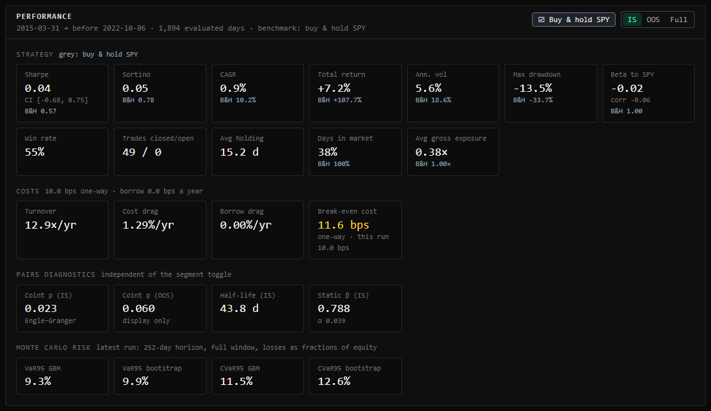 KPI grid with the IS / OOS / Full toggle, costs and the break-even cost | 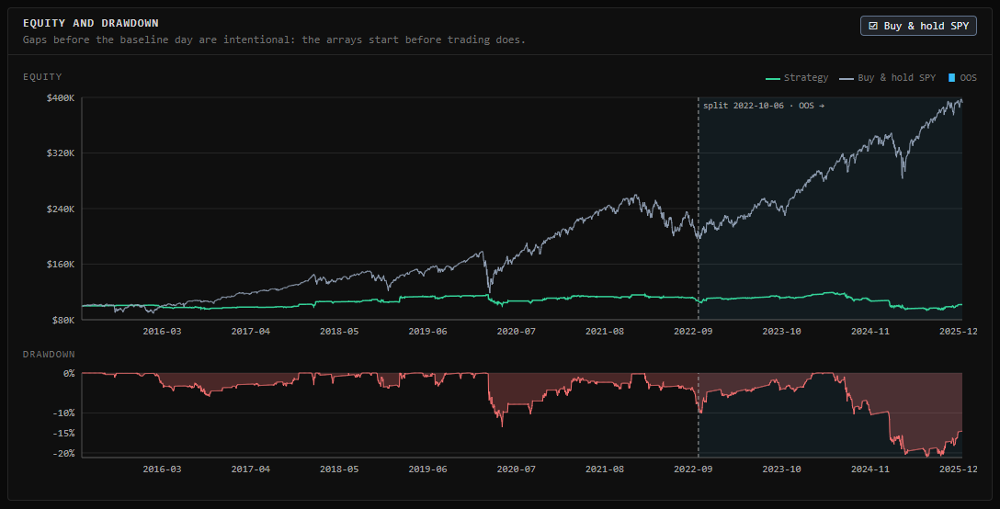 Equity and drawdown, with the OOS segment shaded |
| 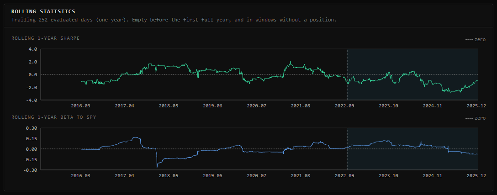 Rolling one-year Sharpe and beta to SPY | 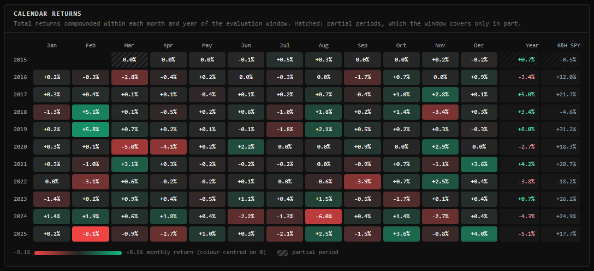 Monthly and annual returns, with partial periods hatched |
| 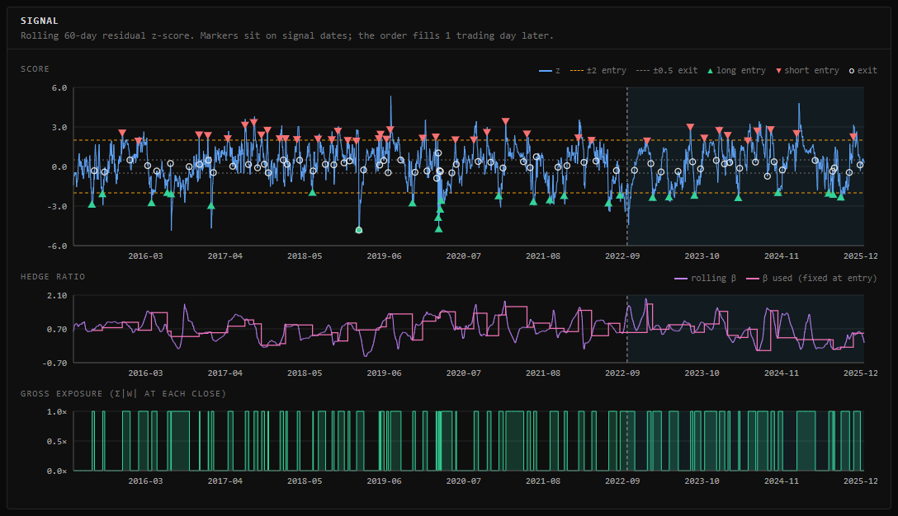 Signal panel: z-score with thresholds and trade markers, hedge ratio, gross exposure | 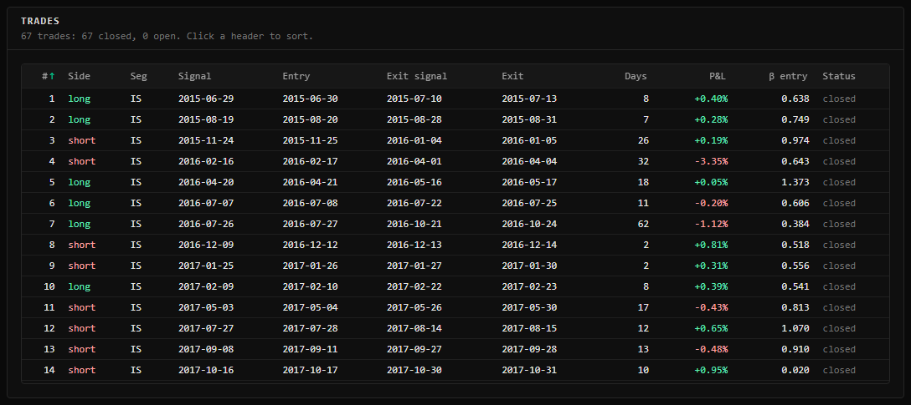 Trades table |
| 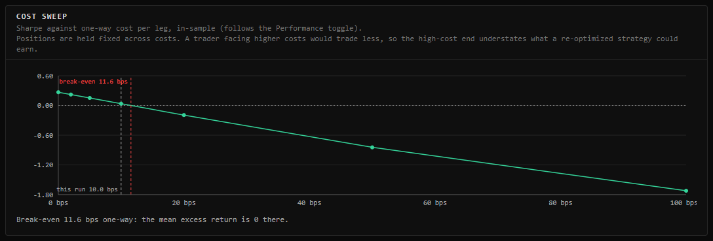 Sharpe against one-way cost, with the break-even cost | 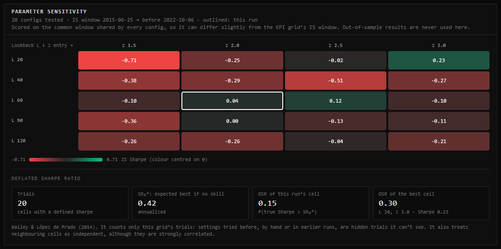 In-sample sensitivity grid and its deflated Sharpe ratios |
| 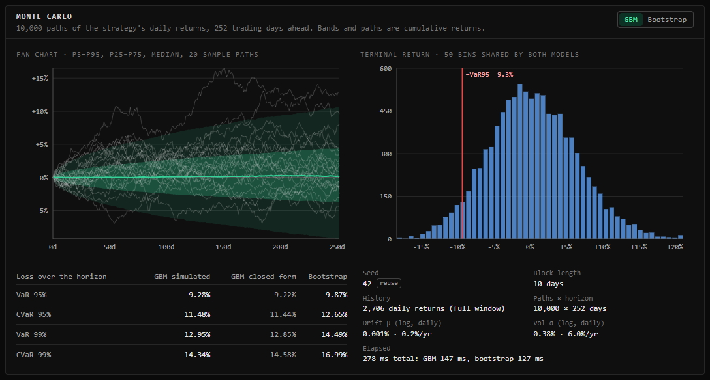 Monte Carlo fan chart, histogram and risk table | |
| 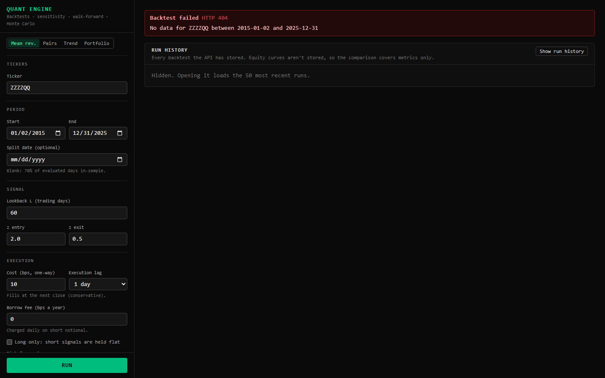 An unknown ticker (404) | 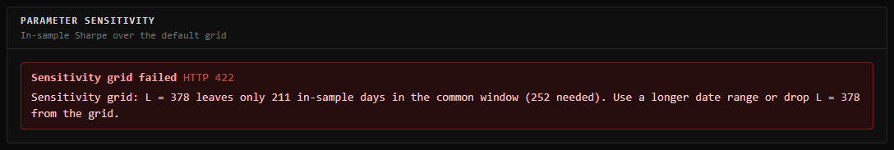 A trend history too short for the grid (422) |

Full-page captures: [KO/PEP pairs](docs/screenshots/dashboard-pairs-full.png) and [SPY trend, 2006–2025, with a 10% volatility target](docs/screenshots/dashboard-trend-voltarget-full.png).
