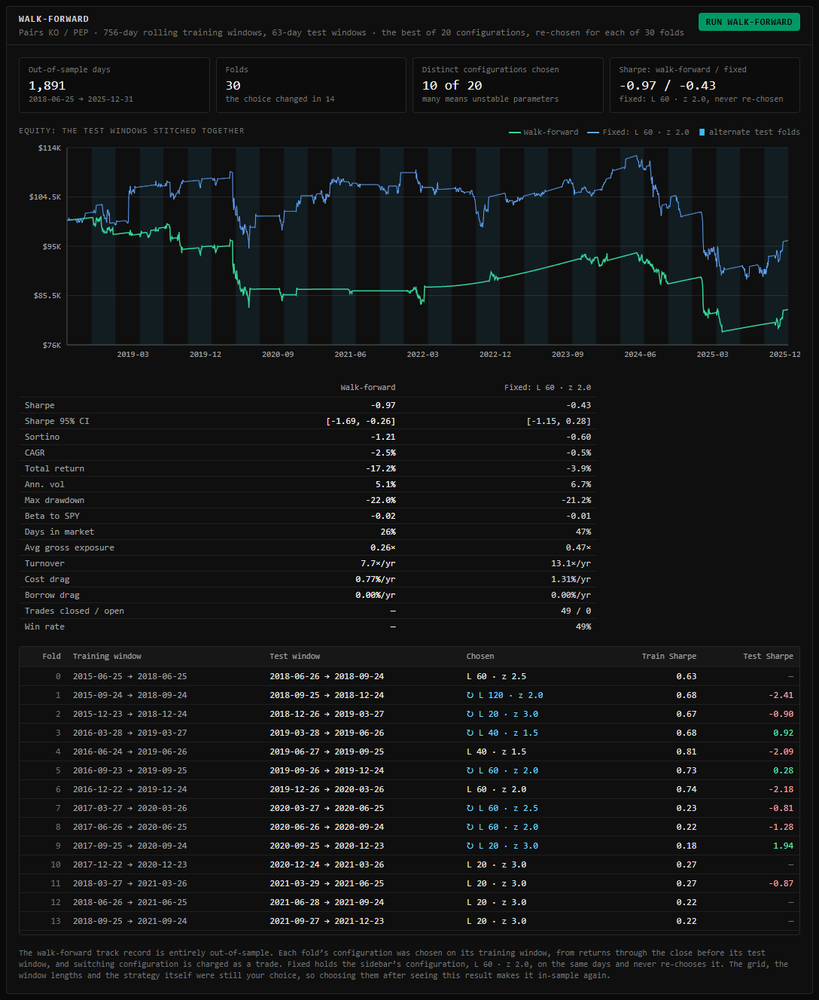
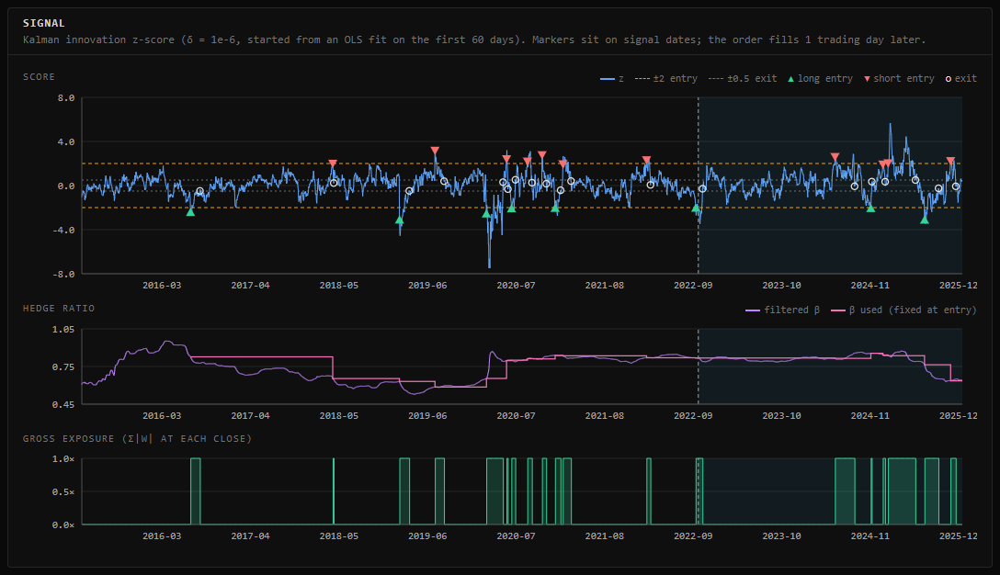
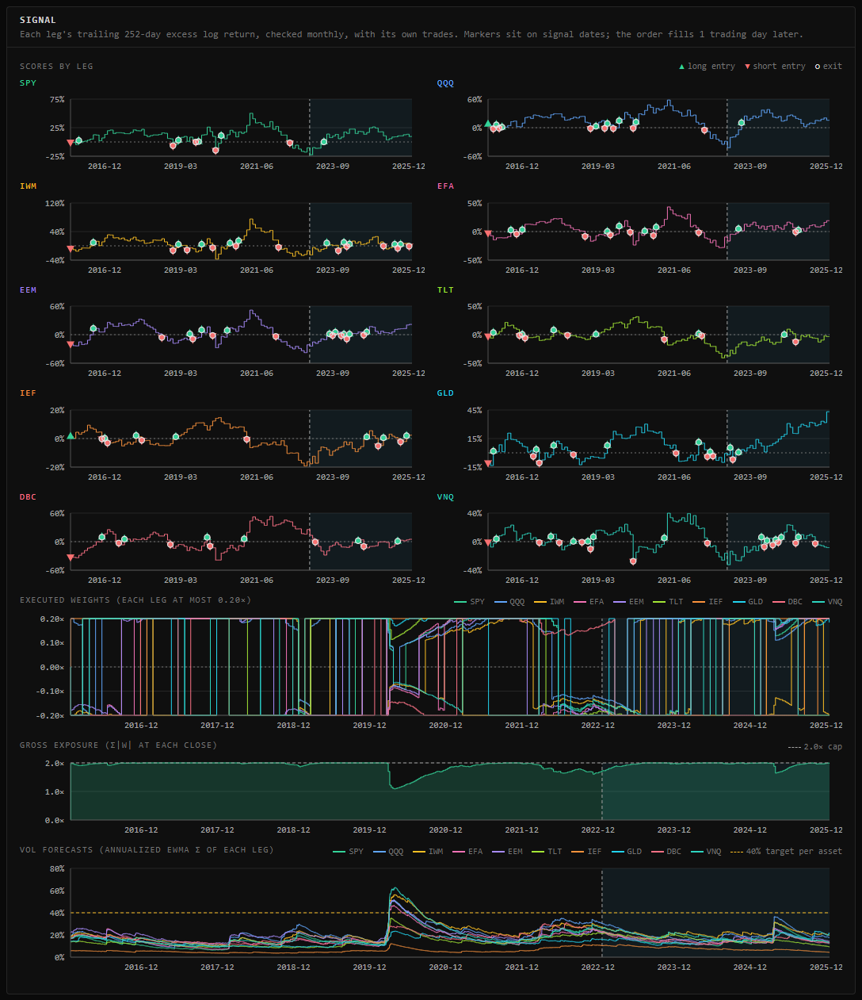
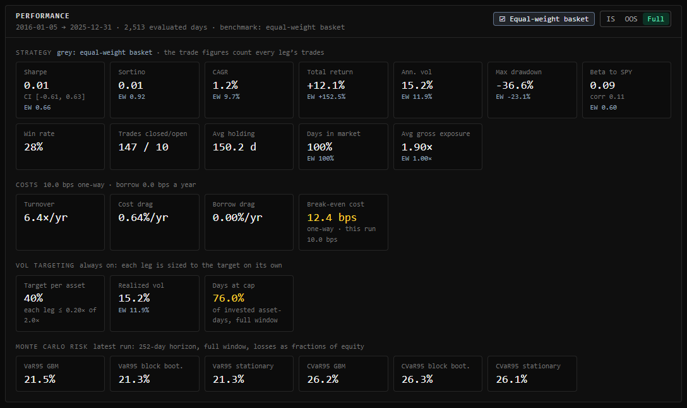
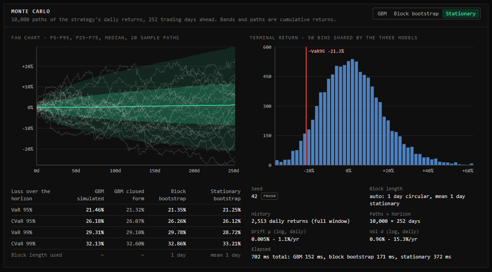
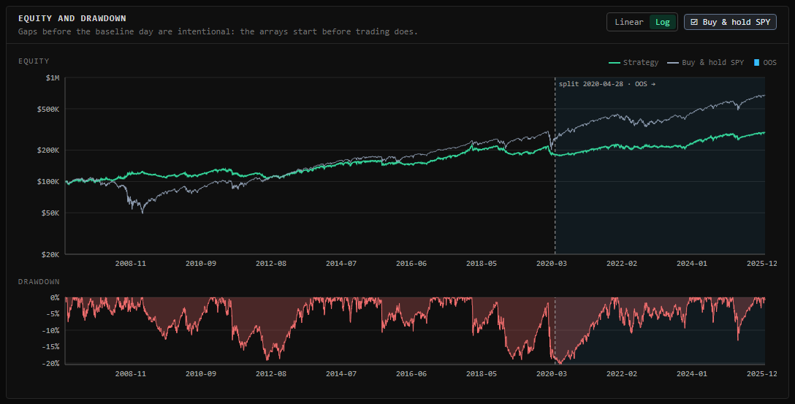
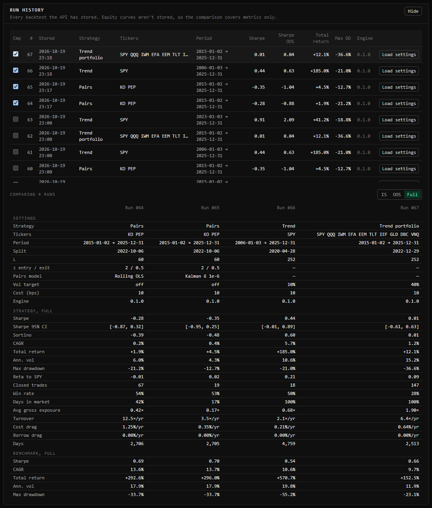

# Quant Engine

A backtesting and Monte Carlo risk engine for daily US equity strategies, with a React dashboard. It runs four strategies:
- single-asset mean reversion;
- pairs trading, with a rolling-OLS or Kalman-filter hedge ratio;
- time-series momentum (trend following) on one asset;
- a multi-asset trend portfolio of 2–12 ETFs, each leg sized to the same volatility.

Each can take a volatility-targeting overlay (the portfolio always has one), and all but pairs have a long-only switch. Results come split in-sample and out-of-sample, with conservative accounting: a one-day execution lag by default, per-leg trading costs, an optional borrow fee on shorts, and cash at the T-bill rate.

Several tools test how much a result can be trusted:
- a cost sweep with the break-even cost;
- rolling one-year Sharpe and beta, and calendar returns;
- a parameter grid with the deflated Sharpe ratio, which discounts the best cell for the number of cells tried;
- a walk-forward analysis, which re-chooses the grid's best configuration on each training window and trades it on the next test window, giving a track record that is out-of-sample throughout;
- Monte Carlo projections with GBM, a circular block bootstrap and a stationary bootstrap, with an optional data-driven block length, checked against closed-form VaR and CVaR.

The dashboard keeps a history of every backtest, with side-by-side comparison and "Load settings". Its settings live in the URL, so a link reproduces a run, and its trades, daily series and calendar returns export as CSV. Browser tests drive it in Chromium against an offline API.

- **Specification:** [CLAUDE.md](CLAUDE.md), the source of truth for every formula and rule.
- **Methodology:** [docs/METHODOLOGY.md](docs/METHODOLOGY.md) justifies each formula, lists the limitations, and records every approved deviation from the specification.
- **Status:** Phases 0–9 are done: the engine, the API, the dashboard, the documentation and the benchmarks, then costs and robustness metrics, walk-forward analysis, the Kalman pairs model, the trend portfolio and the stationary bootstrap, run history, URL state, CSV export, the log scale, offline mode and browser tests, and a [static demo](#static-demo). The demo is built and tested but not deployed yet.


*KO/PEP pairs, 2015-01-02 to 2025-12-31, default settings. More views [below](#screenshots).*

## Setup (PowerShell)

Requires Python 3.12+ and Node 24+.

```powershell
Copy-Item .env.example .env

cd backend
py -m venv .venv
.venv\Scripts\python.exe -m pip install -r requirements-dev.txt

cd ..\frontend
npm ci
```

## Run

```powershell
# Terminal 1: API on http://localhost:8000 (interactive docs at /docs)
cd backend
.venv\Scripts\python.exe -m uvicorn app.main:app --reload --env-file ..\.env

# Terminal 2: dashboard on http://localhost:5173
cd frontend
npm run dev
```

Prices are downloaded from Yahoo Finance on first use and cached in `backend\quant.db`. With `QUANT_OFFLINE=1` set (in `.env` or the shell) the API never downloads: a ticker or date range that isn't cached returns 503.

The sidebar's settings are written to the URL when you press Run, so the link reproduces the run; opening a link fills the sidebar and sends nothing until you press Run. **Run history**, at the bottom of the page, lists every stored backtest. "Load settings" puts a run's settings back in the sidebar, and ticking up to four runs compares their metrics.

## Static demo

A read-only build of the dashboard for GitHub Pages, which replays recorded API responses and needs no backend. It has eight scenarios: pairs on KO/PEP, XOM/CVX, GOOGL/GOOG and NVDA/AMD, mean reversion on KO, SPY trend with the volatility target off and on, and the trend portfolio of SPY, QQQ, GLD and TLT. Each runs 2015-01-01 to 2025-12-31 with the default settings, and includes its sensitivity grid, walk-forward and Monte Carlo (seed 42). The sidebar is read-only apart from a scenario picker. How the replay works is in METHODOLOGY [§33](docs/METHODOLOGY.md).

**Not deployed yet.** The recorded series are derived from Yahoo Finance data, and publishing them waits on a decision about redistributing that data (CLAUDE.md §13). Until then `.github/workflows/pages.yml` builds the demo on every push to `main` but doesn't deploy it. Once deployed it will be at https://jacobchen08.github.io/Quantative-Backtesting-Engine/.

The current recording, in `frontend\public\demo`, was made on 2026-10-20 from data through 2025-12-31: 33 files, 8.65 MB, against a 10 MB limit.

```powershell
# Re-record. Downloads any prices missing from backend\quant.db first; adds nothing to the run history.
cd backend
.venv\Scripts\python.exe scripts\record_demo.py

# Build the demo and serve it at http://localhost:4173/Quantative-Backtesting-Engine/
cd ..\frontend
npm run build:demo
npm run preview:demo
```

## Tests and linters

```powershell
cd backend
.venv\Scripts\ruff.exe check
.venv\Scripts\ruff.exe format --check
.venv\Scripts\python.exe -m pytest

cd ..\frontend
npm run lint
npm test
npm run build
```

The backend tests use synthetic data and a fake network, so they never reach Yahoo. They run in parallel, one worker per core (pytest-xdist); add `-n 0` to run them in one process.

### Browser tests

```powershell
cd frontend
npx playwright install chromium   # once
npx playwright test
```

Playwright starts its own three servers and stops them afterwards: the API on port 8001, offline, on a temporary database that `backend\scripts\seed_e2e.py` fills with the synthetic market (tickers SYNY, SYNX, SYNT and SPY, 2012–2019); a fresh production build on port 4173; and a fresh build of the [static demo](#static-demo) on port 4174. Nothing reaches the network, and dev servers on 8000 and 5173 are left alone. The 14 tests took 69.7 s here (`npx playwright test` in PowerShell on 2026-10-20, including both builds). CI runs them on Ubuntu.

## Benchmarks

Every runtime figure in this repository comes from `scripts/bench.py`:

```powershell
cd backend
.venv\Scripts\python.exe scripts\bench.py
```

The bench keeps its own price cache, `backend\bench.db`, so it never touches the app's database or run history. Its first run downloads the data, and every timed request after that is served from the cache. Requests go through FastAPI's TestClient in process, so the times include validation, the engine, storing the run and JSON encoding, but no network or browser.

The tables below are copied from its output on 2026-10-19 (the Phase 7 run), after the test suite had finished and before the dev servers were started:

- CPU: AMD Ryzen 7 PRO 8840HS w/ Radeon 780M Graphics, 16 logical cores; RAM: 59.7 GiB
- OS: Windows-11-10.0.26220-SP0; Python 3.14.6 (CPython)
- Libraries: numpy 2.5.4, pandas 3.0.6, scipy 1.18.1, statsmodels 0.15.0, arch 8.0.0, fastapi 0.143.2, starlette 1.8.0, pydantic 2.14.1, SQLAlchemy 2.1.4
- Data: KO/PEP pairs, every other setting default, 2011-01-01 to 2025-12-31: 3,772 trading days, from bench.db. This run first downloaded the nine ETFs of the trend portfolio that bench.db didn't have yet (QQQ, IWM, EFA, EEM, TLT, IEF, GLD, DBC, VNQ); no timed request reached the network.
- Each row: 10 timed runs after one warm-up run, wall clock (time.perf_counter)

**CLAUDE.md §14 targets**

| Workload | Median | Min | Max | Target | Met |
|---|---:|---:|---:|---:|---:|
| 15-year pairs backtest, first request on the data (diagnostics computed) | 351 ms | 341 ms | 426 ms | < 300 ms | **no** |
| 15-year pairs backtest, z_entry changed (diagnostics cached) | 159 ms | 152 ms | 183 ms | < 300 ms | yes |
| Default sensitivity grid (20 configurations) | 575 ms | 540 ms | 648 ms | < 5 s | yes |
| Default walk-forward, 15-year pairs (20 configurations) | 603 ms | 573 ms | 634 ms | < 8 s | yes |
| Default Monte Carlo, 10,000 x 252: GBM and block bootstrap (their elapsed_ms) | 236 ms | 232 ms | 245 ms | < 1 s | yes |
| Default Monte Carlo, three models: the request | 633 ms | 621 ms | 642 ms | < 1.5 s | yes |
| Default Monte Carlo, three models: the simulation alone (elapsed_ms_total) | 543 ms | 537 ms | 554 ms | < 1.5 s | yes |
| 15-year Kalman pairs backtest, first request on the data (diagnostics computed) | 341 ms | 334 ms | 506 ms | < 500 ms | yes |

**Pairs backtest by stage (first request on the data)**

| Stage | Median | Min | Max |
|---|---:|---:|---:|
| Load prices and rf from the cache | 52.2 ms | 48.9 ms | 55.5 ms |
| run_strategy (section 5.0, steps 1-6) | 22.8 ms | 21.7 ms | 31.1 ms |
| Diagnostics: two Engle-Granger tests, static OLS, half-life | 184 ms | 172 ms | 206 ms |
| Report: metrics, benchmark, trades, warnings, series | 32.0 ms | 30.5 ms | 33.1 ms |
| Serialization: payload, response model, JSON | 40.6 ms | 39.9 ms | 52.6 ms |
| Sum of the stages | 330 ms | 318 ms | 368 ms |
| Diagnostics from the cache instead (key and lookup) | 0.16 ms | 0.14 ms | 0.19 ms |

The whole request took 351 ms (median). The rest is parsing and validating the request, storing the run, FastAPI's own response handling and the TestClient round trip.

**Parameter iteration: each request changes one field of the one before**

| Field changed | Median | Min | Max | Diagnostics cache |
|---|---:|---:|---:|---:|
| z_entry (1.55, 1.60, ...) | 159 ms | 152 ms | 183 ms | 10 hits, 0 misses |
| L (24, 28, ...), default 70% split | 374 ms | 349 ms | 435 ms | 0 hits, 10 misses |
| L (24, 28, ...), split_date fixed | 165 ms | 157 ms | 222 ms | 10 hits, 0 misses |

**Walk-forward (default: 756 training and 63 test days, rolling)**

| Stage | Median | Min | Max |
|---|---:|---:|---:|
| The request (as in the first table) | 603 ms | 573 ms | 634 ms |
| run_walk_forward alone (no loading or serialization) | 511 ms | 505 ms | 541 ms |

It backtests 20 grid configurations plus the request's own, then makes 46 folds: 2,897 out-of-sample days, on which 15 distinct configurations were chosen.

**Kalman pairs and the trend portfolio**

| Workload | Median | Min | Max |
|---|---:|---:|---:|
| run_strategy, rolling OLS (the default pairs model) | 23.1 ms | 21.7 ms | 29.8 ms |
| run_strategy, Kalman filter (delta 1e-6) | 25.0 ms | 24.1 ms | 31.0 ms |
| Trend portfolio of 10 ETFs: the request | 383 ms | 367 ms | 413 ms |
| Trend portfolio of 10 ETFs: run_strategy alone | 95.1 ms | 91.9 ms | 105 ms |

The trend portfolio (SPY, QQQ, IWM, EFA, EEM, TLT, IEF, GLD, DBC, VNQ; L = 252, a 40% target per asset) runs on the intersection of their calendars: 3,520 series days from 2012-01-03, 219 leg trades.

**Monte Carlo**

| Model (time inside the default request) | Median | Min | Max |
|---|---:|---:|---:|
| GBM | 124 ms | 122 ms | 131 ms |
| Circular block bootstrap (block length 10) | 112 ms | 109 ms | 122 ms |
| Stationary bootstrap (mean block length 10) | 302 ms | 297 ms | 314 ms |
| The request with block_len "auto" | 638 ms | 620 ms | 673 ms |
| The simulation alone with block_len "auto" (elapsed_ms_total) | 545 ms | 533 ms | 586 ms |

With block_len "auto" the block lengths were 2 (circular) and 2 (stationary).

Peak traced memory at the API caps (50,000 paths x 253 days, three models): 216 MB, 2.13x the 102 MB path array (tracemalloc, which sees numpy's buffers).

**What the numbers mean**

- **The first request on new data still misses the 300 ms target**, at 351 ms. About half of it (184 ms) is the two Engle–Granger cointegration tests.
- **The API caches those tests,** because they depend only on the two price series and the split date (METHODOLOGY §20). Changing z_entry, z_exit, costs or the hedge mode reuses them, and the backtest takes 159 ms.
- **Changing L recomputes them under the default split,** because a new lookback moves the default 70% split date. With `split_date` set, L changes hit the cache too (165 ms).
- **The Kalman filter costs about 2 ms** over rolling OLS in `run_strategy` (25.0 ms against 23.1 ms). A first Kalman request, 341 ms against its 500 ms target, is as slow as a first rolling-OLS request because both run the same Engle–Granger tests; the 10 ms between the two medians is run-to-run variation.
- **Runs vary.** The Phase 6 run on 2026-10-17 measured the first pairs request at 334 ms, against 351 ms here, with stage sums of 321 ms and 330 ms.
- **The stationary bootstrap is the slowest model,** at 302 ms against 112 ms for the block bootstrap: it draws a restart flag and a start for every day of every path (METHODOLOGY §29). The three-model request takes 633 ms against its 1.5 s target, and GBM and the block bootstrap together still take 236 ms against their 1 s target.
- **Memory is unchanged** at 216 MB: the peak comes from the block bootstrap, and the stationary bootstrap builds its paths in chunks of 2,048.
- **A 10-ETF trend portfolio takes 383 ms,** with 95 ms in `run_strategy`: ten legs' forecasts, signals and sizing, and per-leg trades.
- **The sensitivity grid and the walk-forward** are well inside their targets, at 575 ms against 5 s and 603 ms against 8 s.

## Screenshots

All taken on 2026-10-19 from the dashboard running against the local API, on Yahoo data, by `npm run screenshots` (`frontend\scripts\screenshots.ts`). With the API on 8000 and `npm run dev` on 5173 running, that script regenerates every file in `docs\screenshots`; it downloads any data the cache lacks. The KO/PEP section views show the in-sample segment, where the cost sweep has a break-even line. The walk-forward view has the buy & hold line hidden with its toggle, so the axis fits the two pairs strategies.

| | |
|---|---|
|  KPI grid with the IS / OOS / Full toggle, costs and the break-even cost |  Equity and drawdown, with the OOS segment shaded |
|  Rolling one-year Sharpe and beta to SPY |  Monthly and annual returns, with partial periods hatched |
|  Signal panel: z-score with thresholds and trade markers, hedge ratio, gross exposure |  Trades table |
|  Sharpe against one-way cost, with the break-even cost |  In-sample sensitivity grid and its deflated Sharpe ratios |
|  Walk-forward: the test windows stitched together against L 60 / z 2.0 held fixed, the metrics and the fold table |  Monte Carlo fan chart, histogram and risk table |
|  KO/PEP with the Kalman model: the innovation z-score and the filtered hedge ratio |  Trend portfolio of 10 ETFs: each leg's score and trades, the executed weights, gross exposure and each leg's vol forecast |
|  The trend portfolio's KPI grid against its equal-weight basket, with the per-asset target and the legs' days at their cap |  Monte Carlo of the trend portfolio with automatic block lengths, showing the stationary bootstrap |
|  SPY trend with a 10% volatility target, 2006–2025, on the log scale |  Run history, comparing four stored runs on the full window |
|  An unknown ticker (404) |  A trend history too short for the grid (422) |

Full-page captures: [KO/PEP pairs](docs/screenshots/dashboard-pairs-full.png), [SPY trend, 2006–2025, with a 10% volatility target](docs/screenshots/dashboard-trend-voltarget-full.png), and [the diversified trend portfolio of 10 ETFs, 2015–2025](docs/screenshots/dashboard-trend-portfolio-full.png).
